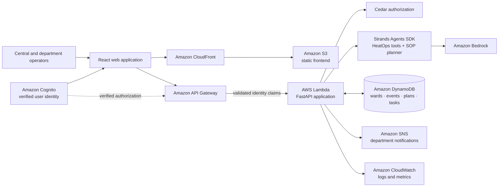

# HeatOps

### From heat alert to coordinated ward-level response

Heatwaves can become emergencies before support reaches the people most at risk. HeatOps helps local response teams turn heat conditions into a prioritized plan, route actions to the right departments, and track what those teams report back.

**Bharat Builds / WeMakeDevs Environmental Hacks · Heatwave response**

> **Project status:** HeatOps is a working local prototype. It uses AWS open-source tools and includes an AWS SAM deployment scaffold, but it is not currently deployed to AWS. The production diagram below describes the target architecture, not a live deployment.

## The challenge

During extreme heat, ward-level teams need to coordinate water, health, labour, and community response quickly. Risk information, resource gaps, and department follow-through can otherwise remain disconnected.

HeatOps brings those pieces into one operator workflow. It is designed to support decisions and coordination—not to replace emergency professionals or claim field actions happened without a department reporting them.

## What HeatOps does

- **Assesses heat risk:** Calculates heat index and severity deterministically from temperature and humidity.
- **Surfaces local needs:** Combines ward conditions with vulnerable-population profiles, available resources, and identified gaps.
- **Builds an actionable plan:** A Strands Agents workflow selects interventions from a backend-approved SOP catalog and produces an explanation.
- **Routes work to people:** A central operator reviews each recommendation, chooses a department, and notifies it.
- **Tracks reported execution:** Department operators acknowledge, initiate, complete, or fail tasks. Updates are persisted with timestamps and failure reasons.
- **Keeps status accountable:** Central operators explicitly refresh task status; department reports do not silently replace the central dashboard snapshot.
- **Supports replanning:** The planner receives previous completed actions and their environmental context.

### Why this matters

The core idea is a **human-coordinated closed loop**: deterministic risk and resource facts inform AI-assisted recommendations, but authorized people decide what to assign and departments report execution. This keeps the plan explainable and distinguishes a recommendation from completed field work.

### Intended impact

HeatOps is designed for ward-level heat-response operators and the departments they coordinate. Its intended benefit is to reduce the coordination gap between identifying heat risk and getting a responsible team to acknowledge and report an action. The demo makes that workflow visible through assigned departments, persisted status updates, and an explicit central refresh. No real-world response-time or health-outcome improvement has yet been measured.

## AWS technology used

The hackathon accepts projects built locally with an AWS open-source tool or projects deployed on AWS. HeatOps takes the local **Build It** path:

| AWS technology | How HeatOps uses it |
| --- | --- |
| **Strands Agents SDK** | Orchestrates the response-planning agent and its tools. |
| **Cedar** | Evaluates policy-based permissions for central and department task operations. |

LocalStack SNS is also supported as an optional local notification integration. The default demo uses local SQLite and console notifications; no AWS account is needed to run it. This README does not claim the application is already deployed to AWS.

## Production architecture (target design)

The following is the intended AWS-hosted architecture. The backend deployment scaffold is in [`infrastructure/template.yaml`](infrastructure/template.yaml); the complete production system—including frontend hosting, verified user authentication, and operational monitoring—still needs to be deployed and validated.



### Production request flow

1. Operators sign in and access the web application through CloudFront.
2. The frontend calls the API Gateway endpoint with verified identity claims.
3. Lambda runs the FastAPI application; Cedar evaluates whether the operator may perform the requested action.
4. Strands gathers ward facts, applies the approved SOP menu, and uses Bedrock for AI planning.
5. DynamoDB stores response plans and department-reported task state; SNS delivers assignment and status notifications.
6. CloudWatch captures application logs and operational metrics.

**Current versus target:** Strands, Cedar, the local FastAPI workflow, SQLite, and console notifications are used in the local prototype. A SAM template describes API Gateway, Lambda, DynamoDB, and Bedrock permissions. CloudFront/S3 hosting, Cognito-backed authentication, production SNS configuration, and end-to-end AWS deployment are target components, not represented as completed deployment.

## Demo workflow

1. Choose a ward and review its heat conditions, at-risk population, and resource gaps.
2. Run the HeatOps agent and inspect its trace, recommended actions, and summary.
3. In **Live Task Tracker**, select a department and acknowledge/notify a recommendation.
4. Open **Department Task Interfaces** and report acknowledgment, work initiation, completion, or failure.
5. Return to **Response Action Plan** and refresh the task to retrieve the department's latest saved status.
6. Simulate changed weather and re-plan to demonstrate how completed-action history informs the next plan.

The seeded ward profiles and weather are demo data. They are not live sensor feeds, official forecasts, or emergency-service integrations.

## Run the prototype locally

### Requirements

- Python 3.12
- Node.js and npm
- Gemini API key for live agent planning

### 1. Configure and start the backend

From the repository root:

```bash
cp .env.example .env
```

Add your `GEMINI_API_KEY` to `.env`, then install and run:

```bash
python3 -m venv .venv
.venv/bin/python -m pip install -r requirements.txt
PYTHONPATH=. .venv/bin/python backend/main.py
```

The API is available at `http://localhost:8000`; interactive API documentation is at `http://localhost:8000/docs`.

### 2. Start the frontend

In another terminal:

```bash
cd frontend
npm install
npm run dev
```

Open the Vite URL printed in the terminal. The default API URL is `http://localhost:8000`; configure `VITE_API_BASE_URL` to use a different backend URL.

### Optional: LocalStack SNS

Console output is the default notification adapter. To publish notifications to a local SNS-compatible endpoint, start LocalStack with SNS enabled and set:

```dotenv
NOTIFICATION_PROVIDER=localstack_sns
LOCALSTACK_ENDPOINT_URL=http://localhost:4566
LOCALSTACK_SNS_TOPIC_NAME=heatops-notifications
```

The app creates the topic at startup and uses LocalStack dummy credentials. No AWS credentials are required for this local option.

## Trust, safety, and current limitations

- The agent proposes actions; it does not directly dispatch emergency services or assert that field work is complete.
- Heat calculations are deterministic; population and resource data are only as current as the supplied data.
- The current UI sends demo `X-HeatOps-Role` and `X-HeatOps-Department` headers. These are **not authentication** and can be forged. Production use requires verified identity claims and authorization at the API boundary.
- Demo records do not represent live municipal systems. Validate operating procedures and data with relevant local authorities before real-world use.
- AWS hosting and integrations shown in the production diagram are not yet deployed and validated end to end.

## Validation

Run backend tests:

```bash
PYTHONPATH=. .venv/bin/python -m pytest -q
```

Build the frontend:

```bash
npm --prefix frontend run build
```

## Project links

- [Hackathon event page](https://www.wemakedevs.org/aws/env)
- [Architecture notes](docs/architecture.md)
- [Agent details](docs/agent.md)
- [Demo walkthrough](docs/demo.md)
