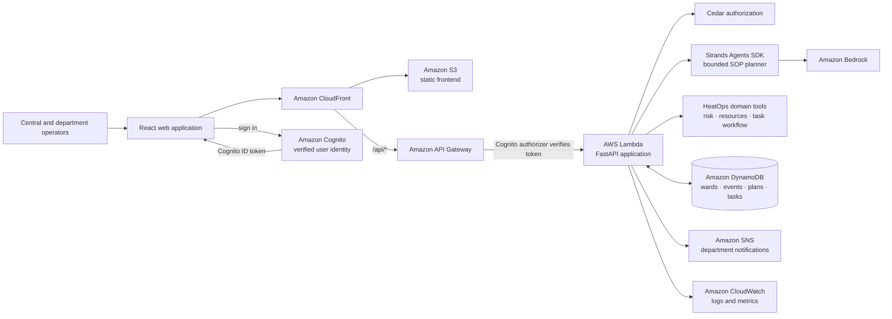

# HeatOps

### From heat alert to coordinated ward-level response

Heatwaves can become emergencies before support reaches the people most at risk. HeatOps helps local response teams turn heat conditions into a prioritized plan, route actions to the right departments, and track what those teams report back.

**Bharat Builds / WeMakeDevs Environmental Hacks · Heatwave response**

> **Project status:** HeatOps is a working local prototype. It uses AWS open-source tools and includes an AWS SAM deployment scaffold, but it is not currently deployed to AWS. The production diagram below describes the target architecture, not a live deployment.

## The challenge

During extreme heat, ward-level teams need to coordinate water, health, labour, and community response quickly. Risk information, resource gaps, and department follow-through can otherwise remain disconnected.

HeatOps brings those pieces into one operator workflow. It is designed to support decisions and coordination—not to replace emergency professionals or claim field actions happened without a department reporting them.

## What HeatOps does

- **Assesses heat risk:** Calculates heat index and severity deterministically from temperature and humidity.
- **Surfaces local needs:** Combines ward conditions with vulnerable-population profiles, available resources, and identified gaps.
- **Builds an actionable plan:** A Strands Agents workflow selects interventions from a backend-approved SOP catalog and produces an explanation.
- **Routes work to people:** A central operator reviews each recommendation, chooses a department, and notifies it.
- **Tracks reported execution:** Department operators acknowledge, initiate, complete, or fail tasks. Updates are persisted with timestamps and failure reasons.
- **Keeps status accountable:** Central operators explicitly refresh task status; department reports do not silently replace the central dashboard snapshot.
- **Supports replanning:** The planner receives previous completed actions and their environmental context.

### Why this matters

The core idea is a **human-coordinated closed loop**: deterministic risk and resource facts inform AI-assisted recommendations, but authorized people decide what to assign and departments report execution. This keeps the plan explainable and distinguishes a recommendation from completed field work.

### Intended impact

HeatOps is designed for ward-level heat-response operators and the departments they coordinate. Its intended benefit is to reduce the coordination gap between identifying heat risk and getting a responsible team to acknowledge and report an action. The demo makes that workflow visible through assigned departments, persisted status updates, and an explicit central refresh. No real-world response-time or health-outcome improvement has yet been measured.

## AWS technology used

The hackathon accepts projects built locally with an AWS open-source tool or projects deployed on AWS. HeatOps uses the local **Build It** path and also includes a deployable AWS production path:

| AWS technology | How HeatOps uses it |
| --- | --- |
| **Strands Agents SDK** | Runs the bounded SOP-selection agent locally with Gemini and in AWS with Bedrock. |
| **Cedar** | Evaluates policy-based permissions for central and department task operations. |

LocalStack SNS is also supported as an optional local notification integration. The default demo uses Strands with Gemini, local SQLite, and console notifications; no AWS account or AWS credentials are needed to run it.

## Production architecture (implemented deployment path)

The AWS path is implemented in [`infrastructure/template.yaml`](infrastructure/template.yaml) and [`infrastructure/deploy-aws.sh`](infrastructure/deploy-aws.sh). Running the deployment script requires an AWS account, AWS CLI/SAM credentials, and Bedrock model access; none are needed for local development. **The stack is deployable code, not a claim that HeatOps has already been deployed.**



### Production request flow

1. The deployment script provisions API Gateway/Lambda, Cognito, DynamoDB, SNS, a private S3 bucket, and CloudFront using AWS SAM.
2. It builds the React app with the deployed Cognito pool/client IDs and uploads it to the private bucket; CloudFront serves the frontend and routes `/api/*` to API Gateway.
3. Cognito signs in admin-provisioned operators. API Gateway validates the ID token; the backend derives central/department role and department from verified claims rather than trusting caller-supplied role headers.
4. The Lambda runs the existing HeatOps workflow and uses Strands for bounded SOP selection with Bedrock. Cedar checks task permissions; application validation remains responsible for task state transitions.
5. DynamoDB stores HeatOps records, SNS sends department assignment/status messages, and Lambda/API Gateway logs and tracing are available through CloudWatch/X-Ray.

The production wiring is selected by settings in the SAM template; local defaults remain SQLite/Gemini/demo identity/console notifications, with Strands active in both modes. The deployment script is the AWS-only step and does not change the local run path. Production startup does **not** seed demo wards. The provisioned stack still needs real operational data supplied, a Bedrock model enabled in the selected region, Cognito operators provisioned into the correct group, and SNS subscriptions configured for the departments that should receive messages. The application publishes the department name as an SNS message attribute so subscriptions can filter notifications by recipient.

### Deploy to AWS

Prerequisites: AWS CLI credentials with CloudFormation/SAM, IAM, Cognito, DynamoDB, SNS, S3, and CloudFront permissions; AWS SAM CLI; Node.js/npm; and access to the selected Bedrock model.

```bash
AWS_REGION=us-east-1 ./infrastructure/deploy-aws.sh
```

The script deploys the infrastructure, builds the Cognito-authenticated frontend, uploads it, and invalidates CloudFront. Override `HEATOPS_STACK_NAME`, `HEATOPS_APPLICATION_NAME`, or `BEDROCK_MODEL_ID` as needed. After deployment, create operator accounts administratively; public self-registration is disabled. For example:

```bash
USER_POOL_ID=<HeatOpsUserPoolId stack output>

aws cognito-idp admin-create-user \
  --user-pool-id "$USER_POOL_ID" \
  --username operator@example.org \
  --user-attributes '[{"Name":"email","Value":"operator@example.org"},{"Name":"custom:department","Value":"Water Dept"}]'
aws cognito-idp admin-add-user-to-group \
  --user-pool-id "$USER_POOL_ID" \
  --username operator@example.org \
  --group-name department
```

For a central operator, omit the department attribute and assign the `central` group instead. Department operators need `custom:department` to match their task department exactly.

This makes the production **architecture and integration paths present in code and deployable**; it does not mean the stack has already been deployed, operational data sources have been connected, or a live emergency service has been validated.

## Demo workflow

1. Choose a ward and review its heat conditions, at-risk population, and resource gaps.
2. Run the HeatOps agent and inspect its trace, recommended actions, and summary.
3. In **Live Task Tracker**, select a department and acknowledge/notify a recommendation.
4. Open **Department Task Interfaces** and report acknowledgment, work initiation, completion, or failure.
5. Return to **Response Action Plan** and refresh the task to retrieve the department's latest saved status.
6. Simulate changed weather and re-plan to demonstrate how completed-action history informs the next plan.

The seeded ward profiles and weather are demo data. They are not live sensor feeds, official forecasts, or emergency-service integrations.

## Run the prototype locally

### Requirements

- Python 3.12
- Node.js and npm
- Gemini API key for live agent planning

### 1. Configure and start the backend

From the repository root:

```bash
cp .env.example .env
```

Add your `GEMINI_API_KEY` to `.env`, then install and run:

```bash
python3 -m venv .venv
.venv/bin/python -m pip install -r requirements.txt
PYTHONPATH=. .venv/bin/python backend/main.py
```

The API is available at `http://localhost:8000`; interactive API documentation is at `http://localhost:8000/docs`.

### 2. Start the frontend

In another terminal:

```bash
cd frontend
npm ci
npm run dev
```

Open the Vite URL printed in the terminal. The default API URL is `http://localhost:8000`; configure `VITE_API_BASE_URL` to use a different backend URL.

### Optional: LocalStack SNS

Console output is the default notification adapter. To publish notifications to a local SNS-compatible endpoint, start LocalStack with SNS enabled and set:

```dotenv
NOTIFICATION_PROVIDER=localstack_sns
LOCALSTACK_ENDPOINT_URL=http://localhost:4566
LOCALSTACK_SNS_TOPIC_NAME=heatops-notifications
```

The app creates the topic at startup and uses LocalStack dummy credentials. No AWS credentials are required for this local option.

## Trust, safety, and current limitations

- The agent proposes actions; it does not directly dispatch emergency services or assert that field work is complete.
- Heat calculations are deterministic; population and resource data are only as current as the supplied data.
- In local demo mode, the UI sends `X-HeatOps-Role` and `X-HeatOps-Department` headers; these are **not authentication** and can be forged. The production path uses an API Gateway Cognito authorizer and the backend derives role/department from verified Cognito claims before Cedar evaluates task access.
- Demo records do not represent live municipal systems. Validate operating procedures and data with relevant local authorities before real-world use.
- The AWS infrastructure and deployment script are implemented, but this repository has not been deployed to an AWS account. Production still requires operator provisioning, Bedrock model access, operational data onboarding, and end-to-end validation.

## Validation

Run backend tests:

```bash
PYTHONPATH=. .venv/bin/python -m pytest -q
```

Build the frontend:

```bash
npm --prefix frontend run build
```

## Project links

- [Hackathon event page](https://www.wemakedevs.org/aws/env)
- [Architecture notes](docs/architecture.md)
- [Agent details](docs/agent.md)
- [Demo walkthrough](docs/demo.md)
